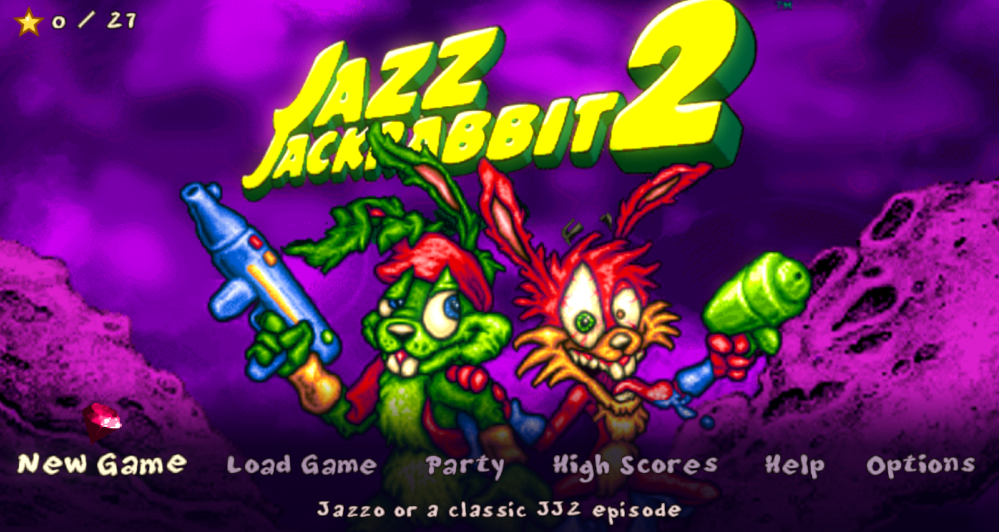
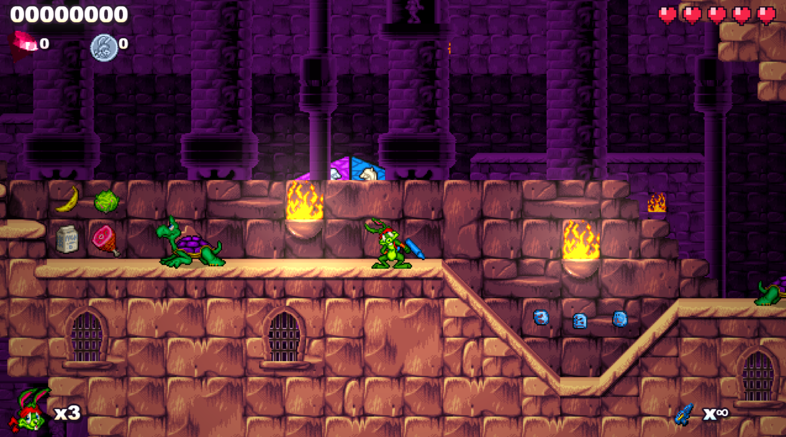

<h1 align="center">Jazzo</h1>

<p align="center">
  <b>An open-source clone of Jazz Jackrabbit 2.</b><br>
  Plays in the browser and on Android phones and tablets, with network games for up to five players.
</p>

<p align="center">
  
  
  
  
</p>

<p align="center">
  <a href="#quick-start">Quick start</a> ·
  <a href="#features">Features</a> ·
  <a href="#android">Android</a> ·
  <a href="#network-mode">Network mode</a> ·
  <a href="#enhancements">Enhancements</a> ·
  <a href="#make-it-yours">Make it yours</a> ·
  <a href="docs/MANUAL.md">Manual</a>
</p>

<p align="center">
  
  
</p>

## Quick start

### Windows

1. Install [Python 3](https://www.python.org/downloads/) if you don't have it.
   During setup, tick **Add python.exe to PATH**.
2. Download Jazzo: choose **Code → Download ZIP** on this page and unzip it,
   or clone the repository with Git.
3. Double-click **`play.bat`**.

The game opens in your default browser at <http://localhost:8870/>. That's it:
there is nothing to build or install.

- A console window stays open while you play. It is the game's local server:
  leave it running, and close it when you are done.
- If the browser opens before the server is ready, refresh the page.
- To host a game for friends on your network, double-click **`party.bat`**
  instead (see [Network mode](#network-mode)).

### macOS and Linux

```bash
git clone https://github.com/h1zn/Jazzo.git
cd Jazzo
python3 serve.py 8870
```

Then open <http://localhost:8870/>.

### Requirements

| | |
| --- | --- |
| **Python** | Python 3, standard library only (no packages to install) |
| **Browser** | Any current browser; WebGL2 is used for the GPU effects when available |
| **Android** | Android 8 or later, for the app |

> Opening `index.html` straight from disk does not work, because browsers
> block JavaScript modules on `file://`. Always start the game through
> `play.bat` or `serve.py`.

## About

Jazzo is a clone of Jazz Jackrabbit 2, the 1998 platformer by Epic MegaGames,
rebuilt from the ground up and released as open source. The engine is plain
JavaScript with no build step: it runs in any modern browser, and the same
game is packaged as an Android app.

Jazzo reads the original game's own file formats (levels, tile sets,
animations, music and films), so it plays the classic episodes and community
level packs. On top of that it adds its own levels, a party mode for up to
five players and a modern renderer.

## Features

| | |
| --- | --- |
| **Classic levels** | Reads `.j2l` levels and `.j2t` tile sets from version 1.20 up to The Secret Files and JJ2+, from folders or `.zip` packs, with parallax layers, animated tiles and pixel-exact collision. |
| **Heroes and arsenal** | Jazz, Spaz and Lori with their own moves, all nine weapons, three shields, the airboard, and the frog and bird morphs. |
| **Bosses** | Ten bosses, each guarding a level exit. |
| **New levels** | Nine levels built for exploring in every direction, each with three stars to earn, secret areas, a bonus room and checkpoints. |
| **Films and music** | Plays the `.j2v` intro and ending films, and `.j2b` and tracker music (`.xm`, `.mod`, `.it`, `.s3m`) through libopenmpt. |
| **Level scripts** | A small interpreter runs the common parts of JJ2+ `.j2as` scripts. |
| **Languages** | English, German, French, Spanish, Italian and Dutch. |
| **Saves and scores** | Eight save slots, a top-ten table, three difficulty levels and continues. |

## Controls

| Action | Keyboard |
| --- | --- |
| Move | Arrow keys or WASD |
| Jump | Space, Z or K |
| Fire | X, J or Ctrl |
| Run | Shift or L |
| Change weapon | C or Tab, or 1 to 9 |
| Pause | P or Esc |
| Fullscreen | Alt+Enter or F11 |
| Help | F1 |

Gamepads and touch screens work too, and every key can be changed in
**Options → Controls**. The [manual](docs/MANUAL.md#controls) has the full
list, including the special moves.

## Android

Jazzo is also an Android app for phones and tablets (Android 8 and up), with
the full game on board and sharp graphics on any screen:

- **Up to 4K**: the picture is drawn on a whole number of the screen's own
  pixels, so nothing is scaled twice on its way to the display.
- **GPU effects** (WebGL2): a choice of upscaler (sharp pixels, smooth, HD
  smooth or a CRT monitor look) and a glow on lights, lava, gems and
  explosions.
- **Touch controls** with a floating stick, plus gamepad and keyboard support.
- **Hosts network games itself**: the phone runs the party server and keeps
  hosting when the app is in the background.

The APK is built from the `android/` folder with JDK 17 and the Android SDK:

```bash
cd android
./gradlew assembleRelease
```

## Network mode

Party mode puts up to five players in one game, on a local network or over the
internet.

- **Four game types**: Treasure Hunt, Battle, Capture the Flag and Race.
- **No addresses to type on Wi-Fi**: phones find hosts on the network by
  themselves. Rooms have a 4-letter code and an optional password.
- **Any mix of devices**: computers join from a browser, phones from the app.
- **Survives a dropped connection**: a guest who loses Wi-Fi keeps their place
  for a minute and rejoins with their gems, hearts and score.
- **Split screen** for two players on the same computer.

| To play | Start it with |
| --- | --- |
| On your local network | `party.bat`, or `python serve.py 8870 --lan` |
| Over the internet | `python serve.py --public` on a machine the players can reach |

The other players open the address the host's lobby shows. The game server and
the party relay are the same small program, with no dependencies.

## Enhancements

What Jazzo adds to the original game:

| Area | Enhancement |
| --- | --- |
| Graphics | 360p to 4K rendering, GPU upscalers, CRT mode and bloom glow |
| Smoothness | Game logic at a fixed 71 ticks a second, with drawing interpolated to the screen's refresh rate |
| Platforms | Runs in the browser and as an Android app, with nothing to install on a computer beyond Python |
| Controls | Touch controls, gamepads, and every key rebindable with up to three keys per action |
| Multiplayer | Five players, hearts, party items, the airboard, reconnection and phone hosting |
| Levels | Nine new levels with stars, secrets, score combos and bonus rooms |
| Level packs | Packs load straight from `.zip` files and borrow missing tile sets from each other; broken maps are detected and hidden |
| Tools | Scripts that check every level can be completed and every classic map loads |

## Make it yours

Jazzo is open source, so nothing in it is fixed: you can change any option
and add anything to the game.

**Change any option, in the game.** The **Options** menu covers video
(resolution, upscaler, glow, scaling, screen shake and flashes), sound and
music volume, every keyboard, gamepad and touch control, the language, and
play settings such as Quick Change. Nothing needs editing by hand.

**Change or add anything, in the code.** There is no build step: edit a file,
refresh the browser, and the change is live.

| To change or add | Look in |
| --- | --- |
| Physics and camera values | `src/config.js` |
| Levels of your own | `src/levels/`, using the level builder in `src/level.js` |
| Level packs | Drop a folder or `.zip` into `Levels/` and it appears in the episode select |
| Enemies, pickups, springs and other objects | `src/entities.js` |
| Weapons | `src/weapons.js` |
| Bosses | `src/bosses.js` |
| Party modes, rules and items | `src/party.js`, `src/partyitems.js` |
| On-screen text and languages | `src/lang.js` |
| Sprites and sounds | `assets/`, with the cutting scripts in `tools/` |
| Music | `Soundtracks/` |

The [manual](docs/MANUAL.md#project-layout) describes every file. Jazzo's code
is under the MIT license, so you are free to modify it and share your version.

## Built with Rea

Jazzo was cloned using the **Rea** concept, on our **Rea Platform**. The Rea
Platform is not public yet; we will publish it later.

## Game data

The repository includes the data the game runs on, so it plays straight after
downloading:

| Folder | Contents |
| --- | --- |
| `assets/` | Sprite sheets, tile sets, fonts and sound samples, with their atlas `.json` files. The scripts in `tools/` are the ones that cut them. |
| `Levels/` | Level packs: folders and `.zip` files holding `.j2l` levels and their `.j2t` tile sets. Drop another pack in and it appears in the episode select. |
| `Soundtracks/` | Recorded music tracks. |

The Jazz Jackrabbit 2 art, sounds, music, films and levels among these files
belong to Epic Games, and the community level packs belong to their authors.
None of that material is covered by Jazzo's license (see [License](#license)).

## Project layout

```
play.bat, party.bat     start the game, or host a network game (Windows)
serve.py                web server and party relay
index.html, style.css   the page
src/                    the game engine (JavaScript modules)
src/jj2/                readers for the original game's level, tile set and script files
assets/                 sprite sheets, tile sets, fonts and sounds
Levels/                 level packs
Soundtracks/            recorded music
android/                the Android app and its party server
tools/                  asset cutters and level checkers
vendor/chiptune3/       libopenmpt player for tracker music
docs/                   the manual
```

## Documentation

The full manual is in [docs/MANUAL.md](docs/MANUAL.md): controls, saving and
difficulty, party mode rules, the level list, classic level support and how
the code is organised.

## Credits

- Jazz Jackrabbit 2 was created by Epic MegaGames. Jazzo is a fan project and
  is not affiliated with or endorsed by Epic Games.
- File formats and boss behaviour follow the research of
  [Jazz² Resurrection](https://github.com/deathkiller/jazz2-native).
- Tracker music plays through
  [chiptune3](vendor/chiptune3/README.txt) and libopenmpt.

## License

Jazzo's own code is released under the [MIT License](LICENSE). The bundled
libraries in `vendor/` keep their own licenses. Jazz Jackrabbit 2 and its
characters, art, sounds, music, films and levels are the property of Epic
Games, and the community level packs in `Levels/` belong to their authors;
those files are in the repository but are not covered by this license.
